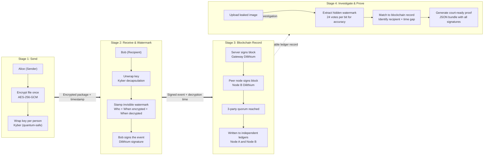
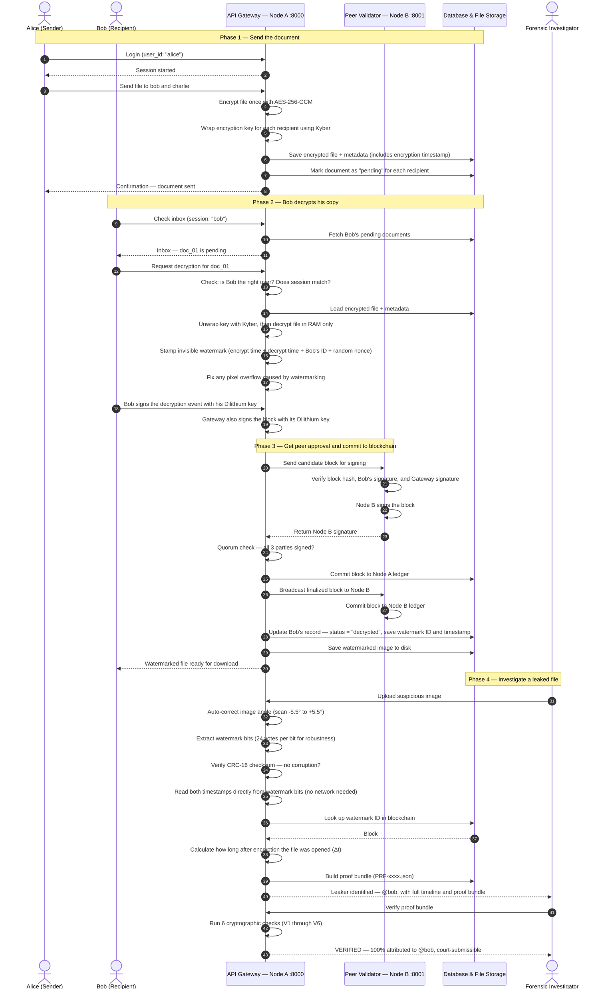
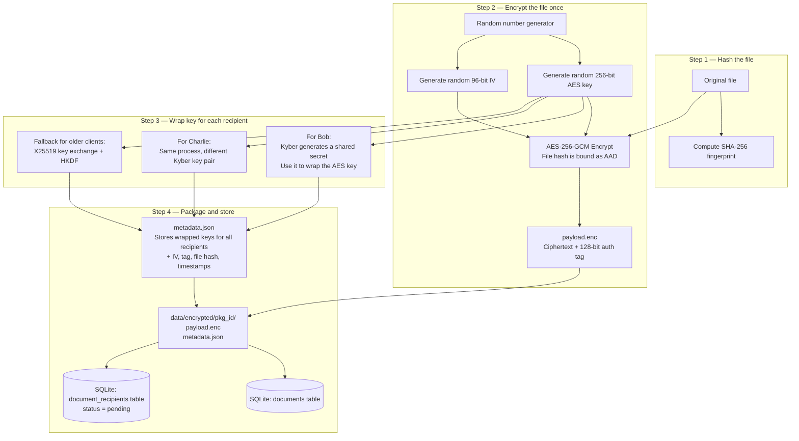
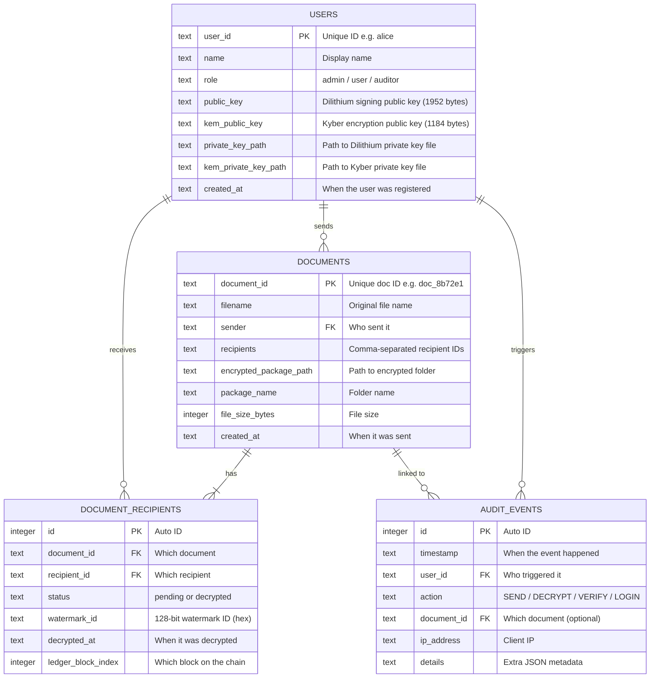
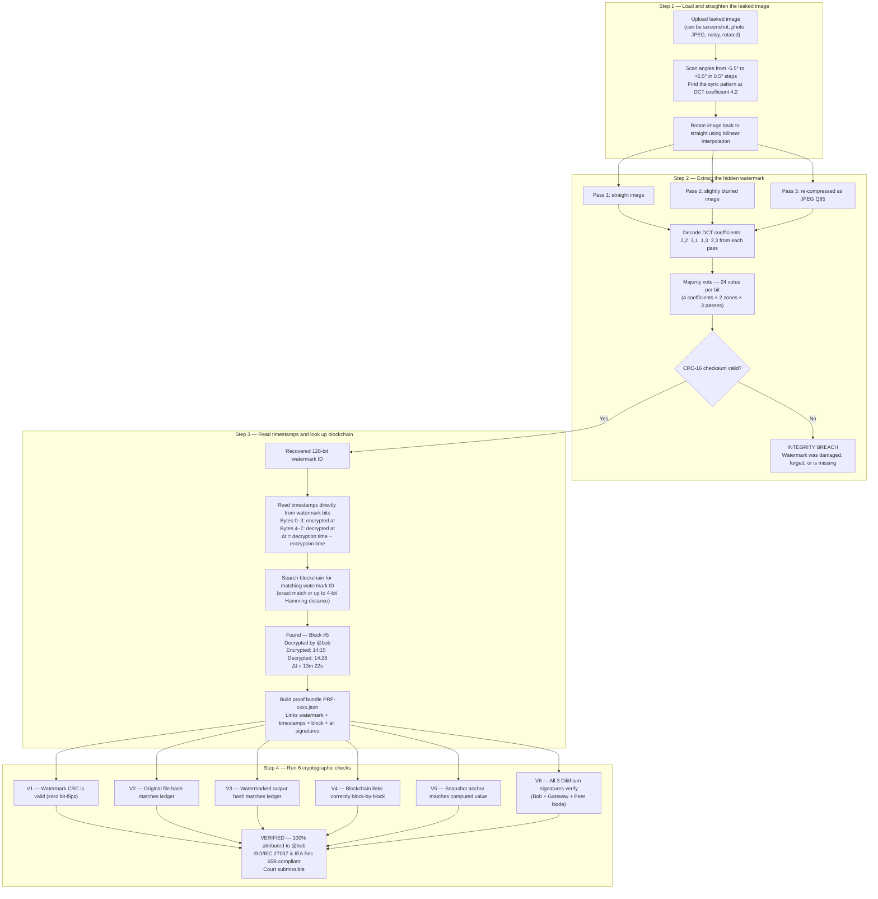
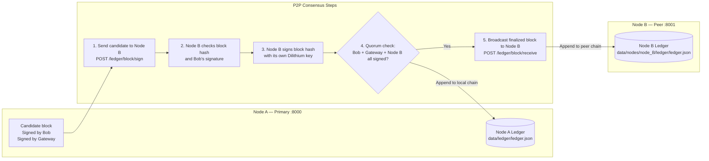

# SANKET — Document Leak Tracking with Post-Quantum Cryptography

> **Quantum-Safe Encryption · Invisible Watermarking · Multi-Node Blockchain · Court-Grade Proof**  
> *Built for Smart India Hackathon (SIH) — Problem Statement PS237*

---

## 1. The Problem & The Solution

### The Problem with Shared Documents
When you send the same document to multiple people, everyone gets an identical copy. If a copy leaks, you have no way to know who shared it.

```
                                      ┌───► Bob gets a copy   ──► Identical file
[Alice sends file] ──► Encrypted ──► ├───► Charlie gets a copy ─► Identical file
                       once           └───► David gets a copy  ──► Identical file
                                                    │
                                           [File is leaked!]
                                                    ▼
                                       WHO DID IT? ANYONE COULD HAVE.
```

- **Same file, same watermark** = useless for finding the leaker.
- **Server logs** can be deleted by an admin.
- **Shared watermarks** don't identify a specific person.

### How SANKET Solves It
Every step from distribution to decryption is recorded and signed, so you can always trace a leaked file back to exactly who opened it:

$$\mathbf{Distribute} \longrightarrow \mathbf{Authorize} \longrightarrow \mathbf{Decrypt} \longrightarrow \mathbf{Consensus} \longrightarrow \mathbf{Attribute} \longrightarrow \mathbf{Verify}$$

1. **One encryption, per-person key wrapping** — The file is encrypted once (AES-256-GCM). A separate quantum-safe key (ML-KEM-768 / Kyber) is locked for each recipient individually.
2. **Session-locked decryption** — Only the logged-in user matching `X-User-ID` can decrypt their copy. Anyone else gets `HTTP 403 Forbidden`.
3. **Watermark stamped in RAM** — Before the file ever touches disk, an invisible mark carrying the recipient's identity + both timestamps is embedded in memory.
4. **Recipient must sign** — The recipient's quantum-safe signing key (ML-DSA-65 / Dilithium) signs the decryption event. They cannot deny it happened.
5. **3-party blockchain record** — The event is only written to the ledger after three independent parties sign: the recipient, the server gateway, and a peer validator node.
6. **Tamper-proof checkpoints** — A snapshot hash is computed every 5 blocks. If anyone alters history, the snapshot won't match, and the ledger is flagged **`COMPROMISED`**.
7. **Court-ready proof file** — A JSON proof bundle is generated, linking the watermark in the leaked image to the signed blockchain record.

---

## Table of Contents
- [1. The Problem & The Solution](#1-the-problem--the-solution)
- [2. System Architecture Overview](#2-system-architecture-overview)
- [3. Full User Journey & Sequence](#3-full-user-journey--sequence)
- [4. How Encryption Works](#4-how-encryption-works)
- [5. How Decryption & Watermarking Work](#5-how-decryption--watermarking-work)
- [6. Database & File Storage](#6-database--file-storage)
- [7. Forensic Verification & Legal Proof](#7-forensic-verification--legal-proof)
- [8. Multi-Node Consensus Network](#8-multi-node-consensus-network)
- [9. Technical Specifications](#9-technical-specifications)
- [10. Implementation Phases](#10-implementation-phases)
- [11. REST API Reference](#11-rest-api-reference)
- [12. Command Line Interface](#12-command-line-interface)
- [13. Frontend Dashboard](#13-frontend-dashboard)
- [14. Installation & Deployment](#14-installation--deployment)
- [15. Tests & Benchmarks](#15-tests--benchmarks)
- [16. License & Attribution](#16-license--attribution)

---

## 2. System Architecture Overview

SANKET is a four-stage pipeline. Each stage feeds into the next:



---

## 3. Full User Journey & Sequence

Five actors are involved: **Alice (Sender)**, **Bob (Recipient)**, the **API Gateway (Node A :8000)**, the **Peer Validator Node (Node B :8001)**, and the **Forensic Investigator**.



### What Each Person Does:

1. **Sender (`SendScreen.jsx` / `main.py send`)**:
   - Pick a file and choose recipients. SANKET encrypts it once, creates a separate Kyber-wrapped key for each person, and stores the encryption timestamp. You get a distribution receipt.

2. **Recipient (`InboxScreen.jsx` & `DecryptScreen.jsx` / `main.py decrypt`)**:
   - Check your inbox and open a pending document. Your session identity is enforced — only you can decrypt your copy. The file is decrypted entirely in RAM (never saved raw). An invisible watermark is stamped with both timestamps and your identity, then you sign it with your Dilithium key.

3. **Forensic Examiner (`LeakVerifyScreen.jsx` / `main.py verify` & `report`)**:
   - Upload any copy of the leaked file — even if it's been screenshotted, cropped, rotated, compressed, or noisy. SANKET corrects the angle, extracts the watermark using majority voting, reads both timestamps offline from the pixel data, looks up the blockchain record, and generates a court-ready proof bundle.

---

## 4. How Encryption Works

SANKET encrypts the file **once** and wraps the key individually for each recipient — avoiding the need to store a separate encrypted copy per person.



### The Math (simplified):

1. **File fingerprint** — SHA-256 hash of the raw file:
   $$H_{\text{file}} = \text{SHA-256}(F_{\text{raw}})$$

2. **Random key and IV** — Generated fresh for every document:
   $$K_{\text{doc}} \stackrel{R}{\leftarrow} \{0,1\}^{256}, \quad \text{IV} \stackrel{R}{\leftarrow} \{0,1\}^{96}$$

3. **Authenticated encryption** — The file hash is bound as AAD so the ciphertext can't be transplanted to a different document:
   $$(C_{\text{payload}}, T_{\text{gcm}}) = \text{AES-256-GCM-Encrypt}(K_{\text{doc}}, \text{IV}, F_{\text{raw}}, \text{AAD}=H_{\text{file}})$$

4. **Per-recipient key wrapping (Kyber)** — For each recipient $R_i$:
   $$(C_{\text{KEM},i},\ SS_i) = \text{ML-KEM-768.Encaps}(PK_{R_i})$$
   $$\text{WrappedKey}_i = \text{AES-KeyWrap}(SS_i,\ K_{\text{doc}})$$
   - Public key: 1,184 bytes · Ciphertext: 1,088 bytes · Shared secret: 32 bytes

5. **Classical fallback (X25519)** — For clients that don't support Kyber:
   $$SS_{\text{X25519},i} = \text{X25519}(sk_{\text{eph}},\ PK_{R_i})$$
   $$\text{FallbackKey}_i = \text{AES-KeyWrap}(\text{HKDF-SHA256}(SS_{\text{X25519},i}),\ K_{\text{doc}})$$

### Metadata saved with the package (`data/encrypted/{pkg_id}/metadata.json`):
```json
{
  "package_id": "pkg_8b72e19a4f20",
  "original_filename": "classified_intel.png",
  "file_hash": "66ed6ed129e81faf67d4be3ed2349ceb...",
  "algorithm": "AES-256-GCM",
  "iv": "9f2b84e1208d17a35c910284",
  "tag": "a1b2c3d4e5f60718293a4b5c6d7e8f90",
  "sender": "alice",
  "recipients": ["bob", "charlie"],
  "wrapped_keys": {
    "bob": {
      "kem": "ml-kem-768",
      "ciphertext": "038a4f91b7...",
      "wrapped_key": "4c89df12..."
    },
    "charlie": {
      "kem": "ml-kem-768",
      "ciphertext": "99ea01bc52...",
      "wrapped_key": "1290fe34..."
    }
  },
  "encrypted_at": "2026-09-28T14:15:22.901Z"
}
```

---

## 5. How Decryption & Watermarking Work

When an authorized user decrypts a file, **the raw plaintext never touches disk**. Everything from key unwrapping to watermarking to signing happens in RAM, atomically.

```mermaid
flowchart TD
    subgraph Auth ["Step 1 — Check authorization"]
        REQ["Bob requests decryption\nPOST /decrypt with X-User-ID: bob"] --> CHK{"Is Bob a recipient?\nDoes session match?"}
        CHK -->|"No"| DENY["HTTP 403 — Access Denied"]
    end

    subgraph Decrypt ["Step 2 — Decrypt in RAM only"]
        CHK -->|"Yes"| LOAD["Load metadata.json and payload.enc from disk"]
        LOAD --> UNWRAP["Unwrap AES key using Bob's Kyber private key\n(all in RAM)"]
        UNWRAP --> PLAIN["AES-256-GCM decrypt → raw plaintext F_raw\nVerify SHA-256 matches stored hash"]
        PLAIN --> NOWRITE["Raw file never written to disk"]
    end

    subgraph Watermark ["Step 3 — Stamp invisible watermark in RAM"]
        NOWRITE --> YCH["Convert image to YCbCr color space\nWork on the Y (brightness) channel only"]
        YCH --> BLOCKS["Split into 8x8 pixel blocks, apply DCT transform"]
        BLOCKS --> PAYLOAD["Build 144-bit watermark payload:\n[4B] encrypt time  [4B] decrypt time\n[8B] recipient hash  [2B] CRC-16 checksum"]
        PAYLOAD --> EMBED["Embed bits into mid-frequency DCT coefficients\n(positions 2,2  3,1  1,3  2,3)\nStep size adapts to local image contrast"]
        EMBED --> SYNC["Add sync pattern at coefficient (4,2)\nfor angle recovery during forensics"]
        SYNC --> CLIP["Anti-clipping fix:\nIf any pixel would exceed 0–255,\nshift DC coefficient to absorb the overflow\nwithout disturbing watermark bits"]
        CLIP --> IDCT["Apply Inverse DCT → watermarked image F_wm"]
    end

    subgraph Sign ["Step 4 — Sign, commit to blockchain, save"]
        IDCT --> HASH2["Compute SHA-256 of watermarked image"]
        HASH2 --> EVENT["Assemble event record:\nwatermark_id, user_id, timestamps, both hashes"]
        EVENT --> BSIGN["Bob signs event with his Dilithium private key"]
        BSIGN --> QUORUM["3-party consensus:\nGateway signs block hash\nPeer Node B validates and signs block hash"]
        QUORUM --> LEDGER[("Write block to Node A and Node B ledgers")]
        LEDGER --> SQLUP[("Update SQLite: status=decrypted,\nwatermark_id, block index, timestamp")]
        SQLUP --> SAVE["Save watermarked image to disk\ndata/decrypted/file_bob_timestamp.png"]
    end
```



### Step-by-Step Detail:

1. **Authorization** — `X-User-ID` must match the intended recipient. Cross-user decryption attempts return `HTTP 403` and are logged as `UNAUTHORIZED_ACCESS`.

2. **Kyber decapsulation (in RAM)**:
   $$SS_{\text{bob}} = \text{ML-KEM-768.Decaps}(SK_{\text{bob}},\ C_{\text{KEM,bob}})$$
   $$K_{\text{doc}} = \text{AES-KeyUnwrap}(SS_{\text{bob}},\ \text{WrappedKey}_{\text{bob}})$$

3. **AES-GCM decryption (in RAM)**:
   $$F_{\text{raw}} = \text{AES-256-GCM-Decrypt}(K_{\text{doc}}, \text{IV}, C_{\text{payload}}, T_{\text{gcm}}, \text{AAD}=H_{\text{file}})$$
   SHA-256 of the result is verified against the stored hash. The raw file is never written to disk.

4. **Watermark layout (144 bits total)**:

   | Bytes | Size | Content |
   |-------|------|---------|
   | 0–3 | 32 bits | Unix timestamp of encryption ($t_{\text{enc}}$) |
   | 4–7 | 32 bits | Unix timestamp of decryption ($t_{\text{dec}}$) |
   | 8–15 | 64 bits | Recipient binding hash + random entropy |
   | 16–17 | 16 bits | CRC-16-CCITT checksum |

   - Embedded into DCT coefficients `(2,2), (3,1), (1,3), (2,3)` with step size $\Delta \in [38.0,\ 62.0]$, scaled to local block contrast.
   - Sync pattern at `(4,2)` with fixed $\Delta_{\text{sync}} = 80.0$ for rotation recovery.
   - Anti-clipping: if IDCT would push a pixel outside 0–255, the DC coefficient `(0,0)` is adjusted to absorb the overflow — the watermark AC bits are untouched.

5. **Dilithium signing** — Bob's event record is assembled and signed:
   $$\mathcal{E} = \{\text{watermark\_id},\ \text{user\_id},\ \text{timestamps},\ H_{\text{file}},\ H_{\text{decrypted}}\}$$
   $$\sigma_{\text{recipient}} = \text{ML-DSA-65.Sign}(SK_{\text{bob}},\ \text{canonical\_json}(\mathcal{E}))$$

6. **Commit** — After 3-party quorum, the watermarked file is saved to `data/decrypted/file_bob_{timestamp}.png`.

---

## 6. Database & File Storage

SANKET uses **SQLite3 in WAL mode** for metadata, alongside an organized file system layout.

### 6.1 Database Relationships



### 6.2 SQL Table Definitions

```sql
-- Users & their quantum-safe keys
CREATE TABLE IF NOT EXISTS users (
    user_id TEXT PRIMARY KEY,
    name TEXT NOT NULL,
    role TEXT NOT NULL,
    public_key TEXT,           -- Dilithium public key (hex)
    kem_public_key TEXT,       -- Kyber public key (hex)
    private_key_path TEXT,     -- Path to Dilithium private key
    kem_private_key_path TEXT, -- Path to Kyber private key
    created_at TEXT NOT NULL
);

-- Encrypted document registry
CREATE TABLE IF NOT EXISTS documents (
    document_id TEXT PRIMARY KEY,
    filename TEXT NOT NULL,
    sender TEXT NOT NULL,
    recipients TEXT NOT NULL,
    encrypted_package_path TEXT NOT NULL,
    package_name TEXT NOT NULL,
    file_size_bytes INTEGER DEFAULT 0,
    created_at TEXT NOT NULL
);

-- Per-recipient decryption status
CREATE TABLE IF NOT EXISTS document_recipients (
    id INTEGER PRIMARY KEY AUTOINCREMENT,
    document_id TEXT NOT NULL,
    recipient_id TEXT NOT NULL,
    status TEXT DEFAULT 'pending',       -- 'pending' or 'decrypted'
    watermark_id TEXT,                   -- Set after decryption
    decrypted_at TEXT,                   -- ISO-8601 timestamp
    ledger_block_index INTEGER,          -- Which blockchain block
    FOREIGN KEY(document_id) REFERENCES documents(document_id) ON DELETE CASCADE,
    UNIQUE(document_id, recipient_id)
);

-- Immutable audit trail
CREATE TABLE IF NOT EXISTS audit_events (
    id INTEGER PRIMARY KEY AUTOINCREMENT,
    timestamp TEXT NOT NULL,
    user_id TEXT,
    action TEXT NOT NULL,
    document_id TEXT,
    ip_address TEXT,
    details TEXT   -- JSON string with extra context
);

-- Indexes for fast lookups
CREATE INDEX IF NOT EXISTS idx_doc_sender ON documents(sender);
CREATE INDEX IF NOT EXISTS idx_doc_recipients ON document_recipients(recipient_id);
```

### 6.3 Concurrency Settings:
- **WAL mode** (`PRAGMA journal_mode = WAL`) — readers and writers don't block each other.
- **Busy timeout** (`PRAGMA busy_timeout = 5000`) — waits up to 5 seconds for a write lock before giving up.
- **Foreign keys** (`PRAGMA foreign_keys = ON`) — cascading deletes keep data consistent.

### 6.4 Where Everything Is Stored

| What | Location | Description |
|:---|:---|:---|
| Metadata database | `data/sanket.db` | SQLite in WAL mode — all relational data |
| Encrypted files | `data/encrypted/{pkg_id}/` | `payload.enc` + `metadata.json` with wrapped keys |
| Watermarked output | `data/decrypted/file_{user}_{ts}.png` | The file Bob actually downloads |
| Dilithium signing key | `data/keys/{user_id}/dilithium_private.bin` | 4,032 bytes, restricted permissions |
| Kyber decryption key | `data/keys/{user_id}/kyber_private.bin` | 2,400 bytes, restricted permissions |
| Node A blockchain | `data/ledger/ledger.json` | Primary append-only chain |
| Node B blockchain | `data/nodes/node_B/ledger/ledger.json` | Peer's independent chain — no shared storage |
| Snapshot anchors | `data/ledger/anchors.json` | Computed every 5 blocks for tamper detection |
| Proof bundles | `data/proofs/PRF-{id}.json` | Court-ready forensic proof files |
| Analysis reports | `data/reports/REP-{id}.json` | Detailed tamper analysis reports |

---

## 7. Forensic Verification & Legal Proof

SANKET produces evidence that meets international legal standards:
- **ISO/IEC 27037:2012** — Digital evidence collection and preservation.
- **Section 65B, Indian Evidence Act** — Certified electronic records with proof of system integrity.
- **FRE Rule 902(13) & 902(14)** — Self-authenticating records from a certified cryptographic process.

### How Forensic Verification Works



### The 6 Verification Gates (`verify_proof_bundle`):

Each gate is a hard mathematical check — all 6 must pass:

1. **V1 — Watermark integrity** — CRC-16 polynomial confirms zero bit-flips:
   $$\text{CRC-16-CCITT}(W_{\text{id}}) \equiv C_{\text{crc}} \pmod{2^{16}}$$

2. **V2 — Original file hash** — The hash ties the evidence to the exact original file:
   $$H_{\text{file}} = \text{64-char hex string, matches package metadata}$$

3. **V3 — Watermarked output hash** — Confirms the saved watermarked file matches what's in the block:
   $$H_{\text{decrypted}} = \text{64-char hex string, matches decryption event}$$

4. **V4 — Hash chain continuity** — Every block links correctly to the one before it; genesis block has 64 zeros:
   $$\text{Block}[k].\text{prev\_hash} = \text{Block}[k-1].\text{block\_hash}$$

5. **V5 — Snapshot anchor** — Cumulative hash of every block up to this checkpoint must match:
   $$\text{Anchor}_m = \text{SHA-256}(\text{all blocks } B_0 \text{ to } B_{5m-1} \text{ serialized})$$

6. **V6 — 3-party signatures** — All three Dilithium signatures must verify independently:
   $$\text{Verify}(PK_{\text{bob}},\ \mathcal{E},\ \sigma_{\text{bob}}) = \text{True}$$
   $$\text{Verify}(PK_{\text{gateway}},\ H_{\text{block}},\ \sigma_{\text{gateway}}) = \text{True}$$
   $$\exists\, p \in \text{Peers} : \text{Verify}(PK_p,\ H_{\text{block}},\ \sigma_p) = \text{True}$$

### Proof Bundle Output (`PRF-xxxx.json`):
```json
{
  "proof_id": "PRF-f0402966c4a7",
  "generated_at": "2026-09-28T14:30:10.128Z",
  "attributed_user": "bob",
  "confidence_score": 100.0,
  "verdict": "VERIFIED_HIGH_CONFIDENCE",
  "forensic_watermark": {
    "watermark_id": "f0402966c4a79cc2ca98e4c67014b474",
    "crc_valid": true,
    "majority_votes_per_bit": 24,
    "angular_skew_corrected_deg": 1.5
  },
  "timestamps": {
    "encrypted_at": "2026-09-28T14:15:22.901Z",
    "decrypted_at": "2026-09-28T14:28:45.312Z",
    "elapsed_seconds": 802.4,
    "elapsed_formatted": "13m 22s",
    "embedded_in_watermark": true
  },
  "blockchain_evidence": {
    "block_index": 5,
    "block_hash": "cb104928ac8129480bcde12349182374...",
    "prev_hash": "8f3b2591a38402db399b1ef059882...",
    "cumulative_anchor": "5d2f8319a9240bc1284ae987654..."
  },
  "cryptographic_signatures": {
    "recipient_dilithium": "07eae737e8398dbcba1c9edb...",
    "gateway_dilithium": "466b94df39802a78c3855a20...",
    "peer_validator_dilithium": "eb4854d03888bd63af2544..."
  },
  "legal_certification": {
    "standard": "ISO/IEC 27037 & IEA Section 65B",
    "admissibility": "COURT_SUBMISSIBLE",
    "tamper_detected": false
  }
}
```

### 7.1 Timestamps in the Watermark
Both timestamps ($t_{\text{enc}}$ and $t_{\text{dec}}$) are embedded directly in the image pixels:
- An investigator with only the leaked image can read both timestamps **offline** — no server, no network.
- The ledger cross-checks these timestamps to prevent forgery.
- Transit time $\Delta t = t_{\text{dec}} - t_{\text{enc}}$ shows exactly how long after sending the file was opened.

---

## 8. Multi-Node Consensus Network

Every validator node keeps its own independent copy of the ledger. There is **no shared storage**.



### Quorum Rule:
A block is only accepted when **all three** of these signatures are valid:
$$\text{Block accepted} \iff \text{Valid}(S_{\text{bob}}) \land \text{Valid}(S_{\text{gateway}}) \land \exists\, p \in \text{Peers}: \text{Valid}(S_p)$$

### Snapshot Anchors (Tamper Detection):
Every 5 blocks, each node computes a hash over all blocks so far:
$$\text{Anchor}_m = \text{SHA-256}(\text{blocks } B_0 \ldots B_{5m-1} \text{ serialized})$$

Nodes compare anchors with peers via `GET /ledger/sync`. Any mismatch marks the ledger **`COMPROMISED`** and isolates the offending node.

---

## 9. Technical Specifications

| Component | Standard | Key Details |
|:---|:---|:---|
| Quantum-safe key exchange | NIST FIPS 203 — ML-KEM-768 (Kyber) | Public key 1,184B · Private key 2,400B · Ciphertext 1,088B |
| Quantum-safe signatures | NIST FIPS 204 — ML-DSA-65 (Dilithium) | Public key 1,952B · Private key 4,032B · Signature 3,309B |
| Classical fallback | X25519 + HKDF-SHA256 (RFC 7748) | For clients that don't support Kyber |
| File encryption | AES-256-GCM | Authenticated; 96-bit random IV; one encryption per file |
| Invisible watermark | 2D DCT-QIM on Y channel (YCbCr) | Mid-freq coefficients (2,2)(3,1)(1,3)(2,3); step Δ ∈ [38, 62] |
| Anti-clipping | Orthogonal DC shift on boundary blocks | Adjusts DC coefficient (0,0) to prevent pixel overflow |
| Watermark payload | 144 bits: 128-bit ID + 16-bit CRC | 3 embedded copies; 24 votes per bit during recovery |
| Rotation recovery | Angular cross-correlation search | Sync template at (4,2); scans ±5.5° in 0.5° steps |
| Blockchain | Multi-node hash chain | Independent ledgers per node; zero shared storage |
| Consensus | 3-party Dilithium quorum | Recipient + Gateway + ≥1 Peer must all sign |
| Tamper detection | Cumulative snapshot anchors | Every 5 blocks; mismatch → `COMPROMISED` |
| Chain sync on startup | Longest valid chain wins | Queries peers via `GET /ledger/sync` on boot |
| Proof bundles | JSON with all signatures + hashes | Links forensic evidence to blockchain record |
| Database | SQLite3 in WAL mode | `data/sanket.db`; ACID; no race conditions on LAN |
| Backend | FastAPI + Uvicorn (Python 3.12) | REST API with interactive docs at `/docs` |
| Frontend | React + Vite | Glassmorphic dashboard UI |

---

## 10. Implementation Phases

### Phase 1 — Cryptographic Proof Bundles

Source: [`modules/proof/proof_bundle.py`](file:///d:/SIH/ps237/modules/proof/proof_bundle.py)

#### What a proof bundle contains:
```json
{
  "watermark_id": "f0402966c4a79cc2ca98e4c67014b474",
  "user_id": "bob",
  "timestamp": "2026-09-27T15:33:50.128401+00:00",
  "file_hash": "66ed6ed129e81faf67d4be3ed2349ceb...",
  "decrypted_hash": "41fa8912e9b940e7da3c8913b1904a11...",
  "ledger": {
    "block_index": 5,
    "prev_hash": "8f3b2591a38402db399b1ef059882...",
    "block_hash": "cb104928ac8129480bcde12349182...",
    "anchor_hash": "5d2f8319a9240bc1284ae987654..."
  },
  "signatures": {
    "recipient": "07eae737e8398dbcba1c9edb...",
    "gateway": "466b94df39802a78c3855a20...",
    "peers": [{ "node_id": "node_B", "signature": "eb4854d0388..." }]
  },
  "verification": {
    "crc_valid": true,
    "confidence": 91.0,
    "verdict": "HIGH_CONFIDENCE"
  }
}
```

#### Verification checks (`verify_proof_bundle`) — all 6 must pass:
1. **V1** — `crc_valid == true` (watermark has no bit-flips)
2. **V2** — `file_hash` is a 64-char hex string matching the encrypted package
3. **V3** — `decrypted_hash` is a 64-char hex string matching the saved watermarked file
4. **V4** — Each block's `prev_hash` matches the previous block's `block_hash`; genesis starts with 64 zeros
5. **V5** — Snapshot anchor is a valid 64-char SHA-256 hex string
6. **V6** — Three Dilithium signatures all verify: Bob's over the event, Gateway's over the block hash, at least one peer's over the block hash

---

### Phase 2 — Real Multi-Node Distributed Ledger

Source: [`modules/ledger/network.py`](file:///d:/SIH/ps237/modules/ledger/network.py) · [`modules/ledger/hashchain.py`](file:///d:/SIH/ps237/modules/ledger/hashchain.py)

#### Node configuration (`data/node_config.json`):
```json
{
  "node_id": "node_A",
  "port": 8000,
  "peers": ["http://127.0.0.1:8001"]
}
```
Each node has its own Dilithium keypair in `data/keys/{node_id}/` and its own ledger in `data/nodes/{node_id}/ledger/`. **Nodes never share a directory.**

#### Block acceptance rule:
$$\text{Block accepted} \iff \text{Valid}(S_{\text{recipient}}) \land \text{Valid}(S_{\text{gateway}}) \land \exists\, p \in \text{Peers}: \text{Valid}(S_p)$$

#### Snapshot anchors:
$$\text{Anchor}_m = \text{SHA-256}(\text{blocks } B_0 \text{ to } B_{5m-1} \text{ serialized})$$
Compared across nodes via `GET /ledger/sync`. Mismatch → **`COMPROMISED`**.

---

### Phase 3 — User-Side Signing Enforcement

Source: [`modules/crypto/signature.py`](file:///d:/SIH/ps237/modules/crypto/signature.py) · [`modules/crypto/decryption.py`](file:///d:/SIH/ps237/modules/crypto/decryption.py)

1. **Required event fields** — `sign_decryption_event()` requires all five fields to be present. Missing any one raises a `ValueError`:
   - `watermark_id` · `user_id` · `timestamp` · `file_hash` · `decrypted_hash`

2. **Session binding** — `POST /decrypt` rejects requests where `X-User-ID` doesn't match the recipient. `decrypt_file(..., active_session_user=...)` enforces this at the function level too.

3. **Key uniqueness** — `verify_key_uniqueness()` scans all keys in `data/keys/` and ensures no two users share a public or private key.

---

## 11. REST API Reference

| Endpoint | Method | What it does | Auth required |
|:---|:---|:---|:---|
| **System** | | | |
| `/` | GET | System info and version | Public |
| `/status` | GET | Health check, PQC and ledger status | `X-API-KEY` |
| `/job/{job_id}` | GET | Check background job progress | `X-API-KEY` |
| `/audit/events` | GET | View audit trail | `X-API-KEY` |
| **Users & Sessions** | | | |
| `/auth/users` | GET | List registered users and public keys | `X-API-KEY` |
| `/auth/login` | POST | Switch active session | `X-API-KEY` |
| `/auth/me` | GET | Current user profile and keys | `X-API-KEY` + `X-User-ID` |
| **Sending Documents** | | | |
| `/send` | POST | Encrypt and distribute to recipients | `X-API-KEY` + `X-User-ID` |
| `/inbox` | GET | See pending documents for active user | `X-API-KEY` + `X-User-ID` |
| `/documents` | GET | List all documents | `X-API-KEY` |
| `/documents/{id}` | GET | Get one document's metadata | `X-API-KEY` |
| `/encrypt` | POST | Encrypt only (sync or background) | `X-API-KEY` |
| **Decryption** | | | |
| `/decrypt` | POST | Unwrap key → watermark → sign → commit to ledger | `X-API-KEY` + `X-User-ID` |
| **Forensics & Proofs** | | | |
| `/verify` | POST | Extract watermark, attribute leaker, generate proof bundle | `X-API-KEY` |
| `/report` | POST | Detailed tamper analysis report | `X-API-KEY` |
| `/proof/{proof_id}` | GET | Fetch a stored proof bundle | Optional |
| `/proof/verify` | POST | Cryptographically verify a proof bundle | `X-API-KEY` |
| **Blockchain** | | | |
| `/ledger` | GET | Verify local chain integrity and anchors | `X-API-KEY` |
| `/ledger/blocks` | GET | List all blocks with anchors and nonces | `X-API-KEY` |
| `/ledger/peers` | GET | Node identity, port, peers, and Dilithium key | `X-API-KEY` |
| `/ledger/sync` | GET | Fetch chain and anchors for peer sync | `X-API-KEY` |
| `/ledger/sync` | POST | Trigger P2P sync with peer nodes | `X-API-KEY` |
| `/ledger/block/sign` | POST | Peer: validate and sign a candidate block | `X-API-KEY` |
| `/ledger/block/receive` | POST | Peer: accept and store a finalized block | `X-API-KEY` |
| **Downloads** | | | |
| `/shared/packages` | GET | List all encrypted packages | `X-API-KEY` |
| `/shared/decrypted` | GET | List all watermarked output files | `X-API-KEY` |
| `/download/decrypted/{filename}` | GET | Download a watermarked file | Direct link |
| `/download/report/{report_id}` | GET | Download a forensic report | Direct link |
| `/download/encrypted/{name}` | GET | Download encrypted package as zip | Direct link |
| **Admin** | | | |
| `/setup` | POST | Generate PQC keys for a user list | `X-API-KEY` |

---

## 12. Command Line Interface

All operations work 100% offline via `main.py`:

```bash
# Generate quantum-safe keys for users
python main.py setup --users alice,bob,charlie

# Encrypt and send a document
python main.py send --file test.png --recipients bob,charlie --sender alice

# Check inbox for a user
python main.py inbox --user bob

# Decrypt as the authorized recipient
python main.py decrypt --package data/encrypted/pkg_xxx --user bob

# Check if a file contains a valid watermark
python main.py verify --file data/decrypted/test_bob_xxx.png

# Generate a detailed forensic report
python main.py report --file data/decrypted/test_bob_xxx.png

# Print the blockchain ledger
python main.py ledger

# Verify ledger integrity with snapshot anchor checks
python main.py ledger-verify

# Run the full end-to-end demo
python main.py demo
```

---

## 13. Frontend Dashboard

The frontend ([`frontend/src/`](file:///d:/SIH/ps237/frontend/src/)) is a glassmorphic React app with seven screens:

1. **Identity** ([`IdentityScreen.jsx`](file:///d:/SIH/ps237/frontend/src/components/workflow/IdentityScreen.jsx)) — Switch user persona, view Dilithium and Kyber public keys, see session binding status.
2. **Send** ([`SendScreen.jsx`](file:///d:/SIH/ps237/frontend/src/components/workflow/SendScreen.jsx)) — Upload a file, pick recipients, trigger encryption + Kyber key wrapping.
3. **Inbox** ([`InboxScreen.jsx`](file:///d:/SIH/ps237/frontend/src/components/workflow/InboxScreen.jsx)) — View pending documents with live access badges.
4. **Decrypt** ([`DecryptScreen.jsx`](file:///d:/SIH/ps237/frontend/src/components/workflow/DecryptScreen.jsx)) — Decrypt, watermark, sign, and commit — all in one click.
5. **Leak Verify** ([`LeakVerifyScreen.jsx`](file:///d:/SIH/ps237/frontend/src/components/workflow/LeakVerifyScreen.jsx)) — Upload a suspicious file, extract watermark, see leaker attribution and proof bundle.
6. **Ledger** ([`LedgerScreen.jsx`](file:///d:/SIH/ps237/frontend/src/components/workflow/LedgerScreen.jsx)) — Browse the distributed chain, trigger P2P sync, inspect signatures and anchors.
7. **Settings** ([`SettingsModal.jsx`](file:///d:/SIH/ps237/frontend/src/components/SettingsModal.jsx)) — Configure API key, server URL, and theme.

---

## 14. Installation & Deployment

### What You Need
- Python 3.11+ or 3.12+ (64-bit)
- Node.js 18+ and npm
- Works fully offline in air-gapped environments

### Step 1 — Install Dependencies
```bash
# Python backend
pip install -r requirements.txt

# React frontend
cd frontend
npm install
cd ..
```

### Step 2 — Run (Single Node)
```bash
# Terminal 1 — API server
python -m uvicorn api.server:app --host 0.0.0.0 --port 8000 --reload

# Terminal 2 — Frontend
cd frontend
npx vite --host
```

| URL | Purpose |
|---|---|
| `http://localhost:5173` | Web dashboard |
| `http://localhost:8000/docs` | Interactive API docs |
| Default API Key | `sanket-admin-key-2026` |

### Step 3 — Run Two Nodes (for Consensus)

**Windows PowerShell:**
```powershell
# Terminal 1 — Node A (primary)
$env:PORT="8000"; $env:NODE_ID="node_A"
python -m uvicorn api.server:app --host 0.0.0.0 --port 8000

# Terminal 2 — Node B (peer validator)
$env:PORT="8001"; $env:NODE_ID="node_B"; $env:PEERS="http://127.0.0.1:8000"
python -m uvicorn api.server:app --host 0.0.0.0 --port 8001
```

**Linux / macOS:**
```bash
# Terminal 1 — Node A
PORT=8000 NODE_ID=node_A python -m uvicorn api.server:app --host 0.0.0.0 --port 8000

# Terminal 2 — Node B
PORT=8001 NODE_ID=node_B PEERS="http://127.0.0.1:8000" python -m uvicorn api.server:app --host 0.0.0.0 --port 8001
```

**What happens automatically:** Any decryption on Node A sends the candidate block to Node B for signing, collects the quorum, commits locally, then broadcasts the finalized block to Node B.

---

## 15. Tests & Benchmarks

### Run All Unit Tests (17/17 passing)
```bash
python -m unittest discover -s tests -p "test_*.py"
```

**Covers:**
- Session binding enforcement and Dilithium signing
- Key uniqueness across all users
- Consensus quorum (recipient + gateway + peer)
- Independent ledgers (no shared storage between nodes)
- Proof bundle generation and all 6 verification gates
- Tamper detection on proof fields and ledger attacks
- REST API endpoints for proofs and the distributed ledger

### Run Adversarial Robustness Benchmark (24 scenarios)
```bash
python tests/demo.py
```

**Results:**
| Attack | Confidence |
|---|---|
| JPEG compression Q90 / Q70 / Q50 | 100% — CRC valid |
| Gaussian noise σ = 3 / 5 / 10 | 100% |
| Crop 10–20% of image area | 93–95% |
| Rotation ±5°, ±3°, ±1° | Auto-recovered via sync template |
| Random noise / solid gray / gradient (false positive test) | 100% rejection |
| Block tamper / deletion / rehash on ledger | Detected by snapshot anchors |

### Build Frontend for Production
```bash
cd frontend
npm run build
```
Builds in ~8.4s with 0 errors.

---

## 16. License & Attribution

Developed for the **Smart India Hackathon (SIH)** under **Problem Statement PS237**.  
Built with NIST-standardized post-quantum cryptography: `ML-KEM-768` (Kyber) and `ML-DSA-65` (Dilithium).
